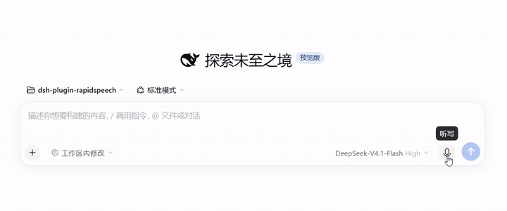

# dsh-plugin-rapidspeech

<p align="center">
  <!-- Upload your demo recording as docs/images/demo.gif to show it here. -->
  
</p>

English | [简体中文](README.zh.md)

Local, offline speech-to-text for the [DeepSeek Harness](https://github.com/deepseek-ai/deepseek-harness) (dsh). Click the microphone in the composer, speak, and the recognized text is inserted into your draft — transcribed by a [RapidSpeech.cpp](https://github.com/RapidAI/RapidSpeech.cpp) `rs-server` running on your own machine. **Audio never leaves your computer.**

## Features

- **Fully offline** — audio, model inference, and transcripts stay on this machine end to end.
- **Managed server** — on first use, dsh downloads the `rs-server` binary and your chosen model, verifies their integrity, spawns the server on a loopback port, and reclaims it after idle time. No manual services.
- **Model switching from the plugin page** — pick a model in the plugin's settings; it downloads on the next recording and hot-swaps. Every downloaded model stays cached, so switching back is instant.
- **Curated model catalog** — X-ASR, SenseVoice, and FunASR-Nano from RapidAI's official mirrors (ModelScope, HuggingFace, hf-mirror), each pinned to a SHA-256.
- **Coexists with other providers** — installs beside the official SenseVoice plugin; pick a provider per recording from the voice-input selector.
- **External mode** — point the plugin at an `rs-server` you run yourself; the plugin then only connects and never manages it.

## Requirements

- DeepSeek Harness **0.2.2 or newer** (npm CLI or Desktop app)
- CPU with **AVX2** — Intel Haswell (2013) / AMD Excavator (2015) or newer. Both the
  Linux and Windows builds target AVX2 as their baseline, so the requirement is
  identical on either OS.
- Disk: ~200 MB–1 GB per model; RAM: ~1–2 GB while transcribing
- Windows x64 and Linux x64

## Install

### From the plugin marketplace (Desktop / Web UI)

Two ways — both put **RapidSpeech ASR (local)** in your plugin list:

- **Search and install** (simplest): open the market's install page, search for
  `dsh-plugin-rapidspeech`, and install it. The package lives on the official npm
  registry; if your npm mirror lags behind, give it a few minutes or point the
  registry back at `registry.npmjs.org`.
- **Index source** (curated card with a description): add this index URL in the
  market's index settings, then find **RapidSpeech ASR (local)** and install:

  ```
  https://github.com/yoletPig/dsh-plugin-rapidspeech/releases/latest/download/market-index.json
  ```

### From the CLI

```bash
dsh plugin --profile <your-profile> add dsh-plugin-rapidspeech
```

Or install a specific release artifact without any build tooling:

```bash
# Download dsh-plugin-rapidspeech-<version>.tgz from GitHub Releases, then:
dsh plugin --profile <your-profile> add ./dsh-plugin-rapidspeech-<version>.tgz
```

<details>
<summary>Installing from a git checkout</summary>

```bash
git clone https://github.com/yoletPig/dsh-plugin-rapidspeech.git
cd dsh-plugin-rapidspeech
npm install          # the prepare script builds lib/
dsh plugin --profile <your-profile> add ./dsh-plugin-rapidspeech
```

On pnpm ≥ 10, the first `add` from git asks you to allow the build script — add the
package key printed by pnpm to the profile's `pnpm-workspace.yaml` under `allowBuilds`.
</details>

## Quick start

1. Start dsh and open the composer.
2. Click the microphone, then **Install** when prompted — the rs-server binary and the
   model download in the background (one-time, ~180 MB for the default model).
3. Record. Stop, and the transcript appears in your draft, ready to edit and send.

The server reclaims itself after 5 idle minutes and wakes in about 2 seconds on the
next recording.

## Models

| `modelId` | Size | Languages | Mirrors |
| --- | --- | --- | --- |
| `xasr-q8_0` *(default)* | 178 MB | auto, zh, en | ModelScope |
| `sense-voice-small-q4_k` | 182 MB | auto, zh, en, yue, ja, ko | HuggingFace, hf-mirror, ModelScope |
| `funasr-nano-q4_k_m` | 692 MB | auto, zh, en | HuggingFace, ModelScope |

### Switching models

Open the plugin's page in dsh and pick a model — the field is live: the next
recording downloads it (after your consent) and subsequent recordings use it.
All catalog models live in the same cache, so switching back to a previously
downloaded model needs no download.

X-ASR is only published on ModelScope, so the HuggingFace mirror is not offered
for it; choosing an unavailable mirror fails explicitly rather than falling back.

### Advanced overrides

Set these in the plugin page or in your profile's `cordis.patch.yml` (precedence
top to bottom):

- `modelPath` — use a local GGUF file directly.
- `modelDownloadUrl` — download from any HTTPS URL.
- `modelId` — a catalog entry.

## Configuration

| Field | Default | Description |
| --- | --- | --- |
| `managementMode` | `managed` | `managed`: the plugin downloads, spawns, and reclaims its server. `external`: connect to an existing rs-server at `endpoint`. |
| `modelId` | `xasr-q8_0` | Catalog model to download. Editable live from the plugin page. |
| `modelDownloadUrl` | — | Any HTTPS GGUF URL; takes precedence over `modelId`. Editable live. |
| `modelPath` | — | Local GGUF file; takes precedence over both. Editable live. |
| `modelSha256` | — | Integrity hash for a manually specified model. Editable live. |
| `dataRoot` | dsh home cache | Directory for the downloaded binary (`bin/`) and models (`models/`). |
| `endpoint` | `http://127.0.0.1:8080` | Server address in `external` mode (loopback or `allowedHosts` only). |
| `serverBinaryPath` / `serverLibraryPath` | — | Use a self-provided binary / shared-library directory. |
| `languages` | `auto, zh, en` | Language hints advertised to the UI (catalog models use their own list). |
| `stripControlTokens` | `true` | Remove SenseVoice-style `<|…|>` markers from transcripts. |
| `requestTimeoutMs` | `120000` | Per-transcription timeout. |
| `maxAudioBytes` | 32 MiB | Recordings above this size are rejected before upload. |
| `prepareTimeoutMs` / `downloadTimeoutMs` | `120000` / `1800000` | Budgets for startup and for one asset download. |
| `idleTimeoutMs` | `300000` | Idle time before the managed server stops; `0` keeps it until unload. |
| `graceMs` | `1000` | Termination grace period. |
| `maxLogBytes` | 64 KiB | Server output tail kept for diagnostics. |
| `allowedHosts` | `[]` | Explicit whitelist for non-loopback `endpoint` hosts. |

## Troubleshooting

- **Download fails with `fetch failed`** — the host cannot reach the download origin.
  On Windows, native dsh does not read the system proxy; declare yours in
  `%USERPROFILE%\.dsh\.env` and restart dsh:
  ```
  HTTPS_PROXY=http://127.0.0.1:7897
  HTTP_PROXY=http://127.0.0.1:7897
  ```
  (Loopback traffic is always direct, so the local server is unaffected.)
- **The server is blocked or silently killed** — antivirus software may flag the
  unsigned binary. Whitelist the cache's `bin/` directory.
- **`Unsupported RapidSpeech language`** — the selected model does not advertise
  the configured language; check the model table above.
- **Linux `Illegal instruction` / Windows `0xC000001D`** — your CPU predates AVX2;
  releases target AVX2 as the minimum.
- **WSL: the Web UI is unreachable from Windows** — use the full token URL printed
  at startup, or bind the WSL address with `--host`.

## License

This plugin is [MIT](LICENSE) licensed. Third-party components are used as follows:

| Component | License | Distribution |
| --- | --- | --- |
| [RapidSpeech.cpp](https://github.com/RapidAI/RapidSpeech.cpp) (the `rs-server` binary is built from its sources in CI) | Apache-2.0 (declared in upstream metadata; the repository ships no license text) | Binary released with a generated `NOTICE.txt` naming the source commit |
| [ggml](https://github.com/ggml-org/ggml) (statically linked) | MIT | `ggml-LICENSE` ships in the same archive |
| ASR models (X-ASR, SenseVoice, FunASR-Nano) | Apache-2.0 per the [RapidAI model repository](https://huggingface.co/RapidAI/RapidSpeech) | Downloaded at runtime from official sources with user consent; never re-hosted here |
| [DeepSeek Harness](https://github.com/deepseek-ai/deepseek-harness) (the host runtime) | MIT | Installed by the user |
