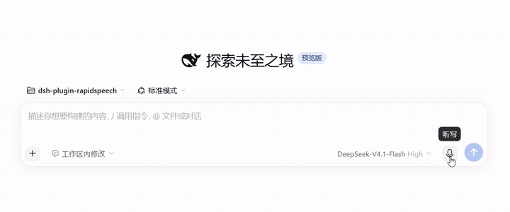

# dsh-plugin-rapidspeech

<p align="center">
  <!-- 将演示动图上传为 docs/images/demo.gif 后会显示在这里。 -->
  
</p>

[English](README.md) | 简体中文

[DeepSeek Harness](https://github.com/deepseek-ai/deepseek-harness)（dsh）的本地离线语音识别插件。点击输入框旁的麦克风说话，识别文本自动插入草稿——由运行在你自己机器上的 [RapidSpeech.cpp](https://github.com/RapidAI/RapidSpeech.cpp) `rs-server` 完成转写。**音频不出本机。**

## 特性

- **完全离线** —— 音频采集、模型推理、转写结果全程留在本机。
- **托管服务** —— 首次使用时 dsh 自动下载 `rs-server` 二进制与所选模型、校验完整性、在回环端口拉起服务、空闲后自动回收。无需手动维护任何服务。
- **插件页面内切换模型** —— 在插件页选择模型，下次录音时经确认下载并热切换。所有已下载的模型都保留在缓存中，切回秒换。
- **精选模型目录** —— X-ASR、SenseVoice、FunASR-Nano 来自 RapidAI 官方镜像（ModelScope、HuggingFace、hf-mirror），均钉定 SHA-256 校验。
- **与其他识别引擎共存** —— 可与官方 SenseVoice 插件并存，录音时在 Provider 选择器中切换。
- **external 模式** —— 指向你自行运行的 `rs-server`，插件只连接、从不接管。

## 环境要求

- DeepSeek Harness **0.2.2 或更新**（npm CLI 或桌面版）
- 支持 **AVX2** 的 CPU —— Intel Haswell（2013）/ AMD Excavator（2015）或更新
- 磁盘：每个模型约 200 MB–1 GB；转写时内存约 1–2 GB
- Windows x64 与 Linux x64

## 安装

### 从插件市场（桌面版 / Web UI）

1. 打开插件市场，进入索引设置，添加以下索引源：

   ```
   https://github.com/yoletPig/dsh-plugin-rapidspeech/releases/latest/download/market-index.json
   ```

2. 在市场中找到 **RapidSpeech ASR (local)**，点击 **安装**。

### 从 CLI 安装

```bash
dsh plugin --profile <你的profile> add dsh-plugin-rapidspeech
```

或安装指定版本产物，无需任何构建工具：

```bash
# 从 GitHub Releases 下载 dsh-plugin-rapidspeech-<版本>.tgz 后：
dsh plugin --profile <你的profile> add ./dsh-plugin-rapidspeech-<版本>.tgz
```

<details>
<summary>从 git checkout 安装</summary>

```bash
git clone https://github.com/yoletPig/dsh-plugin-rapidspeech.git
cd dsh-plugin-rapidspeech
npm install          # prepare 脚本自动构建 lib/
dsh plugin --profile <你的profile> add ./dsh-plugin-rapidspeech
```

pnpm ≥ 10 首次从 git 安装会要求放行构建脚本——把 pnpm 打印的包名加入 profile 的
`pnpm-workspace.yaml` 的 `allowBuilds` 下即可。
</details>

## 快速开始

1. 启动 dsh，打开输入框。
2. 点击麦克风，在提示时点击 **安装** —— rs-server 二进制与模型在后台下载（一次性，默认模型约 180 MB）。
3. 录音。停止后转写文本出现在草稿中，可编辑后发送。

服务空闲 5 分钟自动回收，下次录音约 2 秒唤醒。

## 模型

| `modelId` | 大小 | 语言 | 下载源 |
| --- | --- | --- | --- |
| `xasr-q8_0`（默认） | 178 MB | auto、zh、en | ModelScope |
| `sense-voice-small-q4_k` | 182 MB | auto、zh、en、yue、ja、ko | HuggingFace、hf-mirror、ModelScope |
| `funasr-nano-q4_k_m` | 692 MB | auto、zh、en | HuggingFace、ModelScope |

### 切换模型

打开 dsh 中的插件页面直接选择模型——该字段实时生效：下次录音时经你确认下载，之后的录音即使用新模型。所有目录模型共用同一缓存目录，切回已下载过的模型无需重新下载。

X-ASR 官方仅发布在 ModelScope，因此不提供 HuggingFace 镜像；选择不可用的下载源会显式报错，不会静默回退。

### 高级覆盖

在插件页面或 profile 的 `cordis.patch.yml` 中设置（优先级自上而下）：

- `modelPath` —— 直接使用本地 GGUF 文件。
- `modelDownloadUrl` —— 从任意 HTTPS 地址下载。
- `modelId` —— 使用目录中的条目。

## 配置

| 字段 | 默认值 | 说明 |
| --- | --- | --- |
| `managementMode` | `managed` | `managed`：插件下载、拉起并回收服务。`external`：连接已有 rs-server（`endpoint`）。 |
| `modelId` | `xasr-q8_0` | 要下载的目录模型。可在插件页面实时修改。 |
| `modelDownloadUrl` | — | 任意 HTTPS GGUF 地址；优先级高于 `modelId`。可实时修改。 |
| `modelPath` | — | 本地 GGUF 文件；优先级最高。可实时修改。 |
| `modelSha256` | — | 手动指定模型时的完整性校验。可实时修改。 |
| `dataRoot` | dsh 主目录缓存 | 二进制（`bin/`）与模型（`models/`）的存放目录。 |
| `endpoint` | `http://127.0.0.1:8080` | `external` 模式的服务地址（仅限回环或 `allowedHosts`）。 |
| `serverBinaryPath` / `serverLibraryPath` | — | 使用自备二进制 / 动态库目录。 |
| `languages` | `auto, zh, en` | 向 UI 声明的语言提示（目录模型使用其自带列表）。 |
| `stripControlTokens` | `true` | 去除 SenseVoice 风格的 `<|…|>` 标记。 |
| `requestTimeoutMs` | `120000` | 单次转写超时。 |
| `maxAudioBytes` | 32 MiB | 超限录音在上传前被拒绝。 |
| `prepareTimeoutMs` / `downloadTimeoutMs` | `120000` / `1800000` | 启动与单资产下载的预算。 |
| `idleTimeoutMs` | `300000` | 托管服务的空闲回收时间；`0` 表示保持运行直到卸载。 |
| `graceMs` | `1000` | 进程终止宽限期。 |
| `maxLogBytes` | 64 KiB | 保留的服务输出诊断尾部。 |
| `allowedHosts` | `[]` | 非回环 `endpoint` 的显式白名单。 |

## 故障排查

- **下载报 `fetch failed`** —— 本机无法访问下载源。Windows 上原生 dsh 不读取系统代理；在 `%USERPROFILE%\.dsh\.env` 中声明代理后重启 dsh：
  ```
  HTTPS_PROXY=http://127.0.0.1:7897
  HTTP_PROXY=http://127.0.0.1:7897
  ```
  （回环流量始终直连，本地服务不受影响。）
- **服务被拦截或静默终止** —— 杀毒软件可能拦截未签名二进制。将缓存的 `bin/` 目录加入白名单。
- **`Unsupported RapidSpeech language`** —— 所选模型不支持配置的语言；参见上方模型表。
- **Linux `Illegal instruction` / Windows `0xC000001D`** —— CPU 不支持 AVX2；发布产物以 AVX2 为最低要求。
- **WSL：Windows 浏览器无法访问 Web UI** —— 使用启动日志打印的完整 token 地址，或用 `--host` 绑定 WSL 地址。

## 许可

本插件以 [MIT](LICENSE) 发布。第三方组件的使用方式：

| 组件 | 许可 | 分发方式 |
| --- | --- | --- |
| [RapidSpeech.cpp](https://github.com/RapidAI/RapidSpeech.cpp)（`rs-server` 二进制由 CI 从其源码构建） | Apache-2.0（上游元数据声明；仓库未随附许可文本） | 二进制随生成的 `NOTICE.txt` 发布，注明来源 commit |
| [ggml](https://github.com/ggml-org/ggml)（静态链接） | MIT | 同一压缩包内附 `ggml-LICENSE` |
| ASR 模型（X-ASR、SenseVoice、FunASR-Nano） | Apache-2.0（[RapidAI 模型仓库](https://huggingface.co/RapidAI/RapidSpeech)声明） | 运行时经用户确认从官方源下载；本仓库不转存 |
| [DeepSeek Harness](https://github.com/deepseek-ai/deepseek-harness)（宿主运行时） | MIT | 用户自行安装 |
